# Estúdio Local (`estudio-local`)

Repositório centralizado de ferramentas, configurações de referência, pipelines locais de hardware (Apple Silicon / MLX / VideoToolbox e workstations CUDA), integrações MCP (ArtCraft e Blender), skills auditadas de animação/vídeo/retenção e metodologia híbrida de produção audiovisual.

**Regra fundamental:** somente código, receitas de instalação e documentação técnica — sem dados de caso, credenciais, pesos de modelos, vozes clonadas, mídias brutas ou arquivos de produção pessoal.

---

## Plataformas: Windows × macOS

O repositório serve duas máquinas diferentes. **Nada específico de sistema fica na raiz**:

| Pasta | Plataforma | Conteúdo |
|---|---|---|
| [macos-pessoal/](macos-pessoal/README.md) | **macOS (Apple Silicon)** | ArtCraft nativo com hashes fixados, scripts de vídeo local (MLX, VideoToolbox, Pixelmator), Blender Metal, mocap, [instalações](macos-pessoal/docs/instalacoes-m5.md) e [pipeline](macos-pessoal/docs/pipeline-video-local.md) |
| [windows/](windows/README.md) | **Windows (CUDA/NVIDIA)** | `.mcp.json` com executáveis `.exe`, ArtCraft portátil, VoiceStudio, WanGP, Codex MCP, scripts de emblema com Cycles/CUDA |
| demais pastas (`docs/`, `metodologia/`, `skills-animacao/`, `video-codigo/`, `generativo/`, `sons/`, `hypit/`, `tests/`) | **comum** | método, skills e receitas que valem nas duas |

> O `.mcp.json` do Windows **não** fica na raiz de propósito: o Claude Code no Mac abriria a raiz e tentaria subir servidores `.exe` que não existem.

---

## Atualização 11/11/2026 — M5 Pro e vídeo local sem nuvem

- [docs/instalacoes-m5.md](macos-pessoal/docs/instalacoes-m5.md): Homebrew, apps Apple (Pixelmator Pro, Final Cut Pro, Motion, Compressor, Logic), `uv tool`, venvs, modelos do Hugging Face e do Ollama, vozes (sistema, TTS em nuvem, OpenVoice) e o que **não** foi instalado.
- [docs/pipeline-video-local.md](macos-pessoal/docs/pipeline-video-local.md): métodos B (cutout 2.5D, ~3 s/plano), LTX-2.3 q4 e A2V (80–180 s/plano) com tempos medidos, o que falhou (`lipdub`) e armadilhas.
- Scripts novos em `macos-pessoal/scripts/video/`: `fabrica_plano.py`, `gerar_bocas.py`, `refazer_1080p.py`, `triar.py`.
- **Este é o repositório único do estúdio.** `producao-midia-design` e `ferramentas-audio-visuais` são subconjuntos exatos deste (nenhum arquivo exclusivo) e estão **substituídos**.

---

## Apresentação e Consolidação dos Repositórios

Este repositório unifica dois acervos anteriores e acrescenta a esteira local de última geração e a metodologia de retenção orientada por dados:

```
┌───────────────────────────────┐  ┌───────────────────────────────┐  ┌────────────────────────────────┐
│  1. ferramentas-audio-visuais │  │   2. producao-midia-design    │  │ 3. Expansão M5 Pro & Retenção  │
│  • ArtCraft (7 apps MCP)      │  │  • Remotion (React 60fps)     │  │  • video_local_m5.py (LTX-2)   │
│  • Blender 3D + Emblema Fiel  │  │  • HyperFrames (HTML/CSS)     │  │  • SeedVR2 + VideoToolbox      │
│  • VoiceStudio + WanGP CUDA   │  │  • Skills 2D e 3D estilizadas │  │  • Mocap MediaPipe → Blender   │
│  • Earshot LUFS + Openverse   │  │  • Composição determinística  │  │  • youtube-agent + 637 GSAP    │
└───────────────┬───────────────┘  └───────────────┬───────────────┘  └────────────────┬───────────────┘
                └──────────────────────────────────┼───────────────────────────────────┘
                                                   ▼
                  ┌──────────────────────────────────────────────────────────────────┐
                  │        NÚCLEO: Metodologia em 5 Camadas (metodologia/)           │
                  │  Camada 1: Descoberta (/yt-viral, outlier múltiplo >= 3x)        │
                  │  Camada 2: Roteiro e Gancho (/yt-script, hookscore >= 70/100)    │
                  └────────┬───────────────┬───────────────┬────────────────┬────────┘
                           ▼               ▼               ▼                ▼
                    ┌─────────────┐ ┌─────────────┐ ┌─────────────┐ ┌──────────────┐
                    │   ROTA A    │ │   ROTA B    │ │   ROTA C    │ │    ROTA D    │
                    │ Vídeo como  │ │ Blender 3D  │ │ Generativo  │ │ Som, Voz &   │
                    │   Código    │ │ & ArtCraft  │ │ Local/Flow  │ │  Auditoria   │
                    └──────┬──────┘ └──────┬──────┘ └──────┬──────┘ └───────┬──────┘
                           └───────────────┴───────┬───────┴────────────────┘
                                                   ▼
                  ┌──────────────────────────────────────────────────────────────────┐
                  │   ENTREGA & CAMADA 5: Master 1080p (-14 LUFS) + Whisper +        │
                  │   Folha de Contato + Corte de Silêncio (deadair.py) + Retenção   │
                  └──────────────────────────────────────────────────────────────────┘
```

1. **De `ferramentas-audio-visuais`:** herdamos a fundação de edição local por MCP (`windows/artcraft/` com 7 aplicativos e `macos-pessoal/` com verificação SHA-256), a modelagem de escudos e emblemas 3D fieis por máscara e mapa de altura no Blender (`docs/3d-*`, `scripts/video/aplicar_emblema.py`), a síntese de voz neural local (`voicestudio/`), geração de vídeo em GPU NVIDIA (`wangp/`), direção de vídeo (`hypit/`) e curadoria/medição sonora (`sons/` com `earshot` offline e `openverse-sfx`).
2. **De `producao-midia-design`:** herdamos a criação visual escalável por código — vídeos programáticos em React/TypeScript (`Remotion`), composições web declarativas (`HyperFrames`), o pipeline `video-codigo/` (HTML/Canvas/SVG/GSAP → MP4 via Playwright + FFmpeg) e as duas skills autorais (`animacao-2d-estilizada` e `animacao-3d-estilizada`).
3. **Da Expansão Local M5 Pro & Retenção:** incorporamos o orquestrador `macos-pessoal/scripts/video/video_local_m5.py` (LTX-2 19B em MLX, Z-Image-Turbo, upscale SeedVR2 Metal, Pixelmator Pro Super Resolution e ProRes/HEVC via VideoToolbox), a captura de movimento de vídeo para armadura 3D (`mediapipe_mocap.py` → `blender_apply_mocap.py`), a receita de diorama/pop-up book no Google Flow (`Omni 1.1 Flash`) e as skills auditadas (`youtube-agent-skill`, `awesome-ai-motion` com 637 técnicas GSAP, `bang-motion` e `vox-explainer`).

---

## Mapa Hierárquico de Diretórios

| Camada / Pasta | Papel na Arquitetura |
|---|---|
| [docs/diagrama-motion.svg](docs/diagrama-motion.svg) | Diagrama hierarquizado em estilo Motion SVG (compatível com GitHub e animado via SMIL nativo) |
| [metodologia/](metodologia/README.md) | **Núcleo em 5 camadas**: descoberta de outliers (`/yt-viral`), roteiro com 21 fórmulas de gancho (`/yt-script`), escolha das rotas visuais, áudio e auditoria de retenção |
| [video-codigo/](video-codigo/SKILL.md) | **Rota A (Código)**: HTML/Canvas/SVG/GSAP → MP4 a 60 fps via Playwright e FFmpeg (zero crédito de API) |
| [skills-animacao/](skills-animacao/README.md) | **Rota A (Skills)**: 2 skills próprias para 10 estilos visuais + catálogo de 8 skills auditadas (`youtube-agent-skill`, `awesome-ai-motion`, `bang-motion`, `vox-explainer`, `anidoodle`, `claude-drawing`, `whiteboard-video`, `javascript-animation`) |
| [artcraft/](windows/artcraft/README.md) | **Rota B (MCP)**: Sete aplicativos ArtCraft por MCP (PhotoCraft, VectorCraft, EffectCraft, PdfCraft, LightCraft, FilmCraft e DesignCraft) |
| [macos-pessoal/](macos-pessoal/README.md) | **Rota B (Apple Silicon)**: Instalador `artcraft.py` com SHA-256 fixado, smoke tests MCP, Blender 5.3 Metal/CPU e composição de vídeo |
| [scripts/](macos-pessoal/SCRIPTS.md) | **Rotas B & C (Automação Local)**: `video_local_m5.py` (LTX-2 MLX, Z-Image-Turbo, SeedVR2, VideoToolbox, Whisper Metal), `pixelmator_lote.py`, `aplicar_emblema.py`, `mediapipe_mocap.py` e `blender_apply_mocap.py` |
| [generativo/](generativo/README.md) | **Rota C (Híbrido/Nuvem)**: Google Flow (Veo 3.1, Nano Banana 2), Omni 1.1/1.2 Flash (diorama papercraft/pop-up book) e ChatGPT Images: roteamento e custos |
| [wangp/](windows/wangp/INSTALL.md) | **Rota C (CUDA Local)**: WanGP para geração de vídeo local em GPU NVIDIA, lançador e liberação de VRAM |
| [hypit/](hypit/README.md) | **Rota C (Direção)**: Skill de direção de vídeo com mídia gerada (`hypit-ai`), auditada, com ressalvas de sigilo |
| [voicestudio/](windows/voicestudio/README.md) | **Rota D (Voz Neural)**: Backend local CUDA, OmniVoice offline e inicialização automática pelo MCP |
| [sons/](sons/README.md) | **Rota D (Áudio & LUFS)**: `openverse-sfx` (efeitos e música CC com créditos) e `earshot` (medir LUFS e criticar áudio offline), auditadas e corrigidas |
| [codex/](windows/codex/README.md) | Integrações MCP, plugins e skills configurados para o Codex e Claude Code |
| [docs/](docs/skills-3d-e-video.md) | Documentação técnica medida: modelagem 3D de emblemas/escudos por máscara e mapa de altura no Blender, vídeo automático em `.pptx`, narração por cenas e inventários |
| [tests/](tests/test_skills.py) | Suíte automatizada de integridade das skills (`test_skills.py`), instalador (`test_artcraft.py`) e smoke test sintético de FFmpeg + Blender (`smoke_media.py`) |

---

## Regras Universais de Produção

1. **Emblema, brasão ou identidade visual oficial nunca é redesenhado por IA:** a IA gera apenas fundo, luz e movimento; o emblema original entra por composição local (`scripts/video/aplicar_emblema.py` ou textura no Blender). → [docs/regra-emblema-nunca-redesenhado.md](docs/regra-emblema-nunca-redesenhado.md)
2. **Higiene e Sigilo:** nenhum prompt enviado a serviços de nuvem (Google Flow, ChatGPT) contém dados de caso, fotos privadas ou credenciais. Tudo o que é sensível roda exclusivamente nas ferramentas locais (ArtCraft MCP, Blender, MLX/LTX-2, WanGP, VoiceStudio, Earshot offline, Whisper local).
3. **Verificação Obrigatória de Saída:** todo vídeo gerado passa por folha de contato / leitura multimodal quadro a quadro e transcrição automática (`video_local_m5.py transcrever` ou Whisper) antes da entrega.

---

## Validação Rápida do Repositório

```sh
python3 -m unittest discover -s tests -v
python3 -m unittest discover -s macos-pessoal -p 'test_artcraft.py' -v
```
