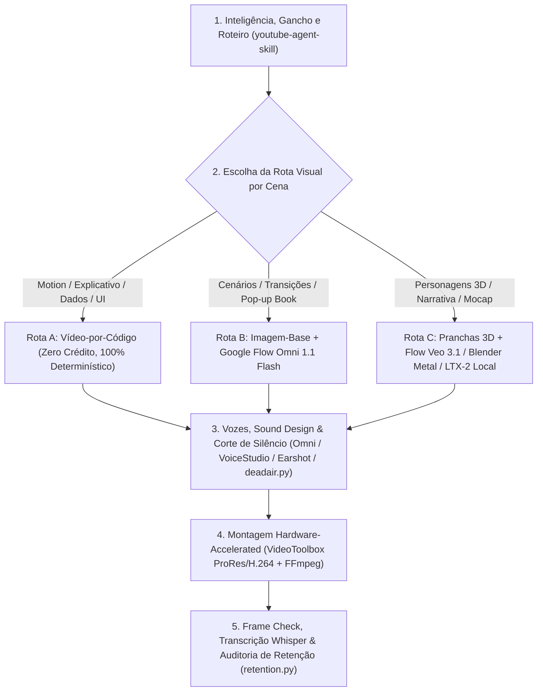

# Metodologia de Produção Audiovisual Híbrida e Engenharia de Retenção

> Data: 2026-11-11 · Tipo: metodologia · Status: vigente

**Resumo:** metodologia unificada que integra descoberta de temas por múltiplo de canal, engenharia de roteiro e retenção (`youtube-agent-skill`), produção visual híbrida em três rotas (vídeo-por-código, diorama generativo no Google Flow e narrativa 3D/local) e auditoria automatizada de quadro e áudio.

---

## Visão Geral em 5 Camadas



---

## Camada 1 — Descoberta de Outliers, Empacotamento e Roteiro (`/yt-*`)

Antes de gerar qualquer ativo visual, definir o empacotamento e pontuar o gancho usando as ferramentas determinísticas em Python stdlib (`Jakeschincariol/youtube-agent-skill`, auditada em 11/11/2026):

1. **Pesquisa de Viralidade por Múltiplo sobre a Mediana (`/yt-viral` + `swipe.py`):**
   - Contagens brutas de visualizações medem o tamanho do canal, não a força da ideia. O indicador real é o **múltiplo sobre a mediana dos últimos vídeos do próprio canal** (`views_do_video / mediana_do_canal`, mínimo de 4 vídeos por canal).
   - Coleta rápida sem login via `yt-dlp --flat-playlist -J <url_do_canal>` → filtragem de outliers com `python3 ~/.claude/skills/yt-viral/swipe.py collected.json --min 2.0`.
2. **Empacotamento Título + Thumbnail como Par Único (`/yt-package` + `title.py`):**
   - Nunca repetir a mesma frase na capa e no título (desperdiça metade da superfície de clique).
   - Validar comprimento (< 60 caracteres no desktop), presença de número/figura concreta e complementaridade entre capa e título:
     ```sh
     python3 ~/.claude/skills/yt-package/title.py --title "Como Automatizei Meu Estúdio em 10 Minutos" --thumb "ZERO TRABALHO MANUAL"
     ```
3. **Engenharia dos Primeiros 15 Segundos (`/yt-script` + `hookscore.py` + `hooks.json`):**
   - Todo gancho cumpre três papéis em 15 segundos: **(a) confirmar o clique** prometido pelo título na primeira frase (evita perda em `0:08`), **(b) abrir uma pergunta** que o espectador não consegue fechar sozinho, e **(c) provar que a entrega existe** mostrando o artefato em até 20 segundos.
   - **Regras inegociáveis:** uma única promessa por gancho; específico vence grandioso; jamais abrir dizendo quem você é (*"Antes de começar, deixa eu me apresentar"* derruba a retenção aos 30 s).
   - Testar 5 variações nas **21 fórmulas catalogadas** (`the-statistic`, `someone-elses-result`, `the-mistake`, `contrarian-flip`, `the-reveal`, `the-teardown`, `the-stack`, `the-warning`, `the-list`, `the-receipt`, `the-insider`, `the-impossible`, `the-comparison`, `the-origin`, `the-deadline`, `the-direct-address`, etc.):
     ```sh
     python3 ~/.claude/skills/yt-script/hookscore.py --hook "97% of channels quit before video 30. Here is what the other 3% do differently."
     ```

---

## Camada 2 — As 3 Rotas de Produção Visual (Fugir da "Cara Genérica de IA")

O segredo para evitar aparência artificial é **nunca pedir o vídeo inteiro a um único modelo difuso**, mas sim combinar três rotas conforme a função de cada plano (mantendo ritmo de **2 a 4 segundos por plano**):

### Rota A — Vídeo-por-Código (Custo Zero, Determinístico, Zero Alucinação)
Indicada para aberturas, tipografia cinética, mapas, diagramas, quadros explicativos e séries 2D estilizadas:
- **`awesome-ai-motion` (`gongnyang/awesome-ai-motion`):** enciclopédia local com **637 técnicas**, **11 receitas** e **7 rotas de design** em HTML/SVG/GSAP. Consultar parâmetros medidos (escala, duração, easing `power3.inOut`) em `index.json` via `jq` e renderizar com `node scripts/render.mjs` (Playwright + FFmpeg → `clip.mp4`, `preview.gif`, `poster.jpg`).
- **`bang-motion` (`bangtutorial/bang-motion`):** openers cinematográficos, bumpers e 5 estilos de explainer em um único `index.html` (`?debug=1`, `export-frames.mjs`).
- **`vox-explainer` (`CK42BB/vox-explainer-skill`) e `whiteboard-video`:** documentários explicativos com mapas vetoriais, rotas tracejadas animadas, carimbos de data e textura de papel/quadro branco.
- **`claude-drawing` (`cloveric/claude-drawing-skill`):** ilustração procedural aparecendo traço por traço em tempo real (`numpy` + `Pillow`).
- **`anidoodle` (`alexgreensh/anidoodle`) + `animacao-2d-estilizada` / `animacao-3d-estilizada`:** pinturas e cenas animadas por código em dezenas de estilos artísticos (aprovando 3 propostas estáticas de quadro antes de animar).
- **`hyperframes` / `remotion` / `video-codigo`:** composição final de timelines programáticas em HTML/React.

### Rota B — Diorama Papercraft / Pop-up Book (Imagem-Base + Google Flow Omni 1.1 Flash)
Indicada para transições de capítulos, apresentação de cenários/mini-mundos e vídeos de história/viagem sem After Effects:
1. **Passo 1 (Imagem-base 16:9 no ChatGPT Images ou Nano Banana 2):**
   > `Layered papercraft diorama of <local>, textured handmade paper, cut-paper layers with depth, <elementos em primeiro plano, plano médio e fundo>, a big paper sun, puffy folded paper clouds, warm golden-hour sky. Landscape 16:9, no text, no people.`
2. **Passo 2 (Animação no Google Flow selecionando `Omni 1.1 Flash`, `16:9`, `x1`):**
   > `Animate this scene in origami form video. The papercraft landmarks, trees, clouds, and hills move and fold dynamically with intricate paper folding and unfolding origami animations. Slow cinematic camera movement across the scene with soft shifting light. Return exactly to the original scene, zero written words: no captions, subtitles, name labels.`
3. **Correção de reconstrução incompleta:** a cláusula **`"return exactly to the original scene"`** impede que o elemento principal dobre no início e só reapareça no último segundo.

### Rota C — Narrativa 3D de Personagens e Estúdio Generativo Local
Indicada para esquetes com personagens recorrentes, séries interativas ("Você Decide" nos comentários) e cenas que exigem controle de câmera ou atuação física:
- **Consistência de Personagem no Flow (`Veo 3.1` / `Omni`):** subir apenas pranchas 3D de referência; para planos com vários personagens à mesa, gerar antes o quadro composto no Nano Banana (até 7 referências) e animar como primeiro quadro.
- **Captura de Movimento Local (`mediapipe_mocap.py` + `blender_apply_mocap.py`):** extrair pose 3D (33 pontos + filtro One Euro) e 52 blendshapes faciais ARKit de qualquer vídeo de referência local e aplicar ao rig no Blender 5.3 (render Cycles com GPU Metal quente em ~3 s por quadro).
- **Geração de Vídeo/Imagem Local no M5 Pro (`scripts/video/video_local_m5.py`):**
  - Descarrega automaticamente modelos do Ollama da RAM unificada (`ollama stop`) antes de rodar MLX.
  - Gera vídeo local com **LTX-2 MLX** (`mlx_video.generate` / `mlx_video.generate_av`), imagem com **Z-Image-Turbo** (`mflux`) e super-resolução com **SeedVR2** ou **Pixelmator Pro** (`pixelmator_lote.py --op superres`).
- **Estúdio Local em ComfyUI (`weblops/openfield` / WanGP):** quando necessário blocagem 3D no navegador (*Stage* → passe de profundidade → *LTX-2.3 Layout-to-Render*) ou transferência de movimento filmado no celular (*Mirror*).

---

## Camada 3 — Extração e Engenharia Reversa de Referências

Para analisar qualquer vídeo de referência aberto no navegador (Reels, Shorts ou YouTube):
1. **Capturar a aba ativa do Google Chrome no macOS:**
   ```sh
   osascript -e 'tell application "Google Chrome" to get {URL of active tab of front window, title of active tab of front window}'
   ```
2. **Baixar vídeo + áudio combinados e metadados JSON:**
   ```sh
   yt-dlp --write-info-json -o "%(id)s.%(ext)s" "<URL>"
   ```
3. **Inspeção multimodal direta:** ler o `.mp4` nativamente no agente (`read_file`, respeitando o limite de **no máximo 2 vídeos por turno** para evitar compactação de contexto) para extrair prompts na tela, estrutura de cortes, links e transcrição da fala.

---

## Camada 4 — Vozes, Corte de Silêncios e Montagem Acelerada por Hardware

1. **Sincronia Labial e Áudio:**
   - Falas geradas dentro do vídeo (Omni) com vozes fixas por personagem, ou síntese local via `voicestudio/` + `rhubarb-lipsync`.
   - Trilha instrumental com *ducking* sob as falas; medição de LUFS e silêncios via `earshot` (`EARSHOT_OFFLINE=1`) ou `video_local_m5.py transcrever`.
2. **EDL de Corte de Silêncios e Capítulos (`deadair.py` + `chapters.py`):**
   ```sh
   python3 ~/.claude/skills/yt-edit/deadair.py transcricao.srt
   python3 ~/.claude/skills/yt-chapters/chapters.py transcricao.srt
   ```
3. **Montagem 1080p com VideoToolbox (`prores_videotoolbox` / `h264_videotoolbox`):**
   - Nos intermediários de montagem, usar `prores_videotoolbox` em paralelo (`ThreadPoolExecutor`) em vez de múltiplas recodificações `libx264`, gerando H.264 final num único passe com Lanczos (`scripts/video/video_local_m5.py upscale-video`).

---

## Camada 5 — Verificação Quadro a Quadro e Auditoria de Retenção

1. **Antes de publicar:**
   - Gerar folha de contato dos clipes e rodar `video_local_m5.py transcrever render_final.mp4` para confirmar que nenhuma fala foi truncada e nenhum texto espúrio apareceu nos quadros.
2. **Depois de publicar (`/yt-retention` + `retention.py`):**
   - Exportar o CSV de retenção do YouTube Studio e cruzar com o `.srt` do vídeo:
     ```sh
     python3 ~/.claude/skills/yt-retention/retention.py retention.csv transcricao.srt
     ```
   - Identificar o segundo exato de cada queda brusca (*cliff*) e a frase falada naquele instante para retroalimentar o próximo roteiro.
